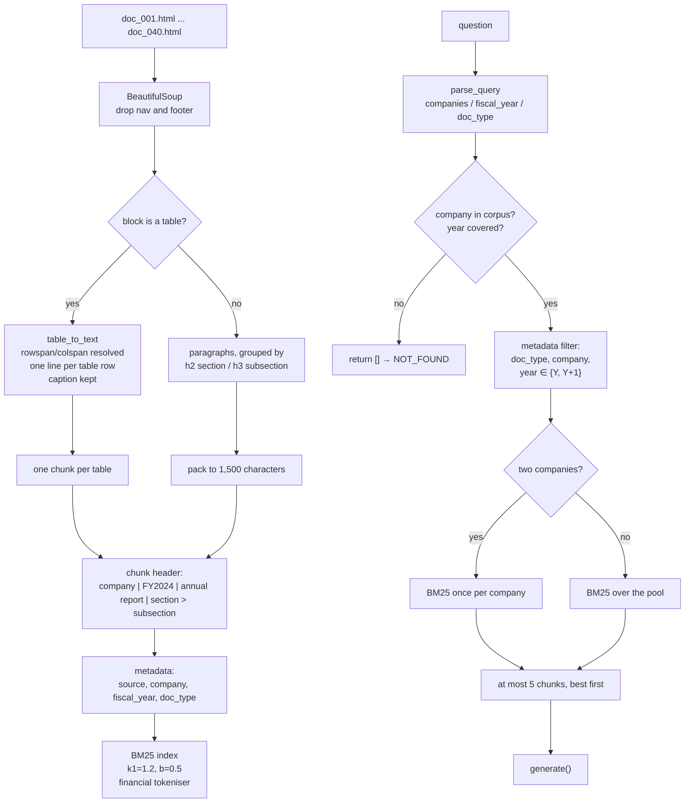

# FTEC5660 Homework 4 — the retrieval half of a RAG assistant

An equity-research desk asks short factual questions about company reports. The generator is fixed
(`deepseek-v4-flash`, temperature 0, five chunks of context); everything that decides **what the
generator sees** is implemented here: HTML table parsing, chunking with metadata, question parsing,
lexical retrieval, and abstention.

## How to run

```bash
python -m venv .venv
# Windows: .venv\Scripts\Activate.ps1      macOS/Linux: source .venv/bin/activate
python -m pip install -r requirements.txt
echo "DEEPSEEK_API_KEY=your_key_here" > .env    # never commit this file
python hw4.py --data-folder public_test
```

`python ablation.py` re-runs the whole pipeline once per variant for the ablation study below
(`--no-generator` skips Task 4 and makes no API calls).

---

# Homework 4 solution

## Results on the public set

| task | points |
|---|---|
| 1.1 `table_to_text` — 12 tables, cell by cell | **8.00 / 8** |
| 1.2 `chunk_document` — 40 documents | **7.00 / 7** |
| 2.1 valid, non-empty retrieval | **5.00 / 5** |
| 2.2 `parse_query` — 3 fields × 60 questions | **10.00 / 10** |
| 2.3 recall@5 (100%, full marks from 90%) | **15.00 / 15** |
| 3 abstention (kept 100%, rejected 71%) | **7.14 / 10** |
| 4 end-to-end answer accuracy (59 / 60) | **19.67 / 20** |
| **Tasks 1–4** | **71.81 / 75** |

By category: table 22/22, fact 12/12, unanswerable 14/14, comparison 11/12.

## The pipeline



**What it does, in one paragraph.** Every document is parsed with BeautifulSoup and the navigation bar
and footer are dropped, so no chunk carries boilerplate text. The body is then walked in document
order, which means every block knows its `h2` section and its `h3` subsection. Tables are never
flattened: `table_to_text` resolves `rowspan` and `colspan` into a real grid and emits one line per
table row — `Revenue | 2024: 2,649.8 | 2023: 2,316.8` — after the caption that carries the unit, so a
number can always be read together with its row label and its column header. Each table becomes its
own chunk; prose is packed paragraph by paragraph inside the same section into chunks of at most
1,500 characters, and every chunk is prefixed with a header built from the document's own metadata and
section title (`Orchid Bay Hotels Ltd. | FY2024 | annual report | 3. Risk factors > Talent`), which
both helps BM25 and tells the generator which company and which year it is reading. The metadata
itself (`source`, `company`, `fiscal_year`, `doc_type`) comes from the `<h1>`, the `<title>` and the
cover block. The index is BM25 (`rank_bm25`, `k1=1.2`, `b=0.5`) over a financial tokeniser that
lower-cases, removes stop words including `usd` and `millions`, and indexes `2,710.4` both as
`2,710.4` and `2710.4`. Retrieval parses the question first, then narrows the candidate pool by
metadata before scoring, and only then ranks by BM25 inside that pool. The year filter is the
important one: the FY2025 annual report also shows FY2024, so a question about fiscal year *Y* can be
answered by the annual report of *Y* or of *Y + 1* — the FY2023 figures live only in the FY2024
report. Comparison questions are retrieved once per company so that both sides reach the generator;
five chunks of one company are a miss. If no company name in the question matches the corpus, or no
document covers the named year, `retrieve` returns `[]` and the generator is never called, so the
answer is `NOT_FOUND` rather than a confident wrong number.

## Ablation study

Each row changes exactly one thing relative to the row above it. Task 1.1 (8.00) and Task 2.2 (10.00)
are constant across the rows because `table_to_text` and `parse_query` are graded on their own; the
switches only decide **whether the retrieval pipeline uses them**.

| variant | change | Task 1.2 | Task 2.1 | recall@5 | Task 2.3 | Task 3 | Task 4 | total |
|---|---|---|---|---|---|---|---|---|
| B0 | naive RAG: `get_text()`, fixed-size chunks, BM25 over the whole corpus, no parsing, never `[]` | 7.00 | 5.00 | 17.4% | 0.00 | 0.00 | 7.00 | 19.00 |
| V1 | + `table_to_text` | 7.00 | 5.00 | 19.6% | 0.00 | 0.00 | 8.00 | 20.00 |
| V2 | + section-aware chunking and the contextual header | 7.00 | 5.00 | 73.9% | 8.97 | 0.00 | 15.33 | 36.30 |
| V3 | + financial tokeniser and stop words | 7.00 | 5.00 | 97.8% | 15.00 | 0.00 | 18.67 | 45.67 |
| V4 | + `parse_query` used as a metadata filter | 7.00 | 5.00 | 97.8% | 15.00 | 3.57 | 19.00 | 49.57 |
| V5 | + one retrieval per company for comparisons | 7.00 | 5.00 | **100.0%** | **15.00** | 3.57 | 19.33 | 49.90 |
| V6 | + abstention | 7.00 | 5.00 | **100.0%** | **15.00** | **7.14** | **19.67** | **53.81** |

Reproduce with `python ablation.py` (it needs the API key for the Task 4 column; `--no-generator`
skips Task 4 and makes no API calls).

**Why each change helped, or did not.**

* **V1 (`table_to_text`): +2.2 points of recall, +1.0 of accuracy.** On its own it barely moves BM25,
  and that is expected: `get_text()` also keeps the digits, so the probe check of Task 1.2 passes
  either way. What `table_to_text` buys is not *recall* but *the right answer out of the chunk*: the
  layout is what lets the generator tell the 2025 column from the 2024 column, and Task 4 goes
  7.00 → 8.00 while `table_score` reaches 8/8.
* **V2 (sections + header): 19.6% → 73.9% recall, 8.00 → 15.33 accuracy.** The largest single jump.
  Chunks now end where a section ends, so a paragraph about liquidity never drags risk factors into the
  same 1,500 characters, and the header injects `company` and `FY2024` into every chunk, which is
  exactly the signal BM25 lacked.
* **V3 (tokeniser): 73.9% → 97.8% recall, 15.33 → 18.67 accuracy.** Two changes matter. Dropping `usd`,
  `millions`, `value` and `december` removes tokens that appear in almost every chunk, and lowering `b`
  from 0.75 to 0.5 stops BM25 from penalising the long table chunks — without it the income-statement
  chunk ranked 6th or 7th behind prose that merely *mentions* gross profit.
* **V4 (metadata filter): no change in recall, +3.57 in Task 3, +0.33 in Task 4.** Recall was already at
  its ceiling, but the filter is what makes abstention possible at all: once the candidate pool is empty
  for a company that is not in the corpus, or for a year that no report covers, returning `[]` becomes a
  decision about metadata rather than a guess about scores.
* **V5 (per-company retrieval): 97.8% → 100% recall.** Two comparison questions were failing because
  BM25 spent the five slots on one company. Retrieving separately per company guarantees both sides are
  present; Task 4 gains another 0.33.
* **V6 (abstention): +3.57 in Task 3, +0.33 in Task 4.** Company-name and year gating reject 10 of the
  14 unanswerable questions with no loss on the answerable side.

## Error analysis

**What still fails.** Four unanswerable questions are not rejected by `retrieve`: *lobbying expenses*,
*carbon offset purchases*, *largest single customer*, *customer churn rate*. In all four the company
exists, the year is covered, and the retriever honestly returns the closest balance-sheet or MD&A
chunks — the figure is simply never disclosed. The generator saved those four on its own: it read the
chunks, saw no figure for a *lobbying expense* or a *churn rate*, and answered `NOT_FOUND`. So the
conservative abstention costs nothing in Task 4 (14/14 unanswerable correct) and only the 2.9 points
that remain on Task 3.

Neither a BM25 score threshold nor a "word not in the corpus" rule separates them: the top-1 scores of
the unanswerable questions (9.2 – 17.1) overlap the answerable ones (5.8 – 20+), and the words that are
missing from the corpus in *answerable* questions are verbs (`generate`, `held`, `guide`, `set`), not
missing figures. A per-question LLM answerability check is the obvious next step; it is deliberately
not enabled, because a single false rejection costs about 1.5 points across Tasks 2.3, 3 and 4, while
one extra correct rejection earns about 2.1 — the margin is too thin to gamble on an untestable rule.

**The one wrong answer (q022).** *"Which company had more total assets at 31 December 2024: Northgate
Payments or Orchid Bay Hotels?"* The retriever did its job — two chunks per company, recall was a hit —
but the generator answered `Northgate Payments Corp.` instead of `Orchid Bay Hotels`. This is the failure
mode the handout warns about: good recall is necessary but not sufficient. Both balance sheets carry two
columns, both companies have a "Total assets" row, and the comparison has to be done across two chunks.
Ranking the larger figure first, or attaching the company name to every table row, would make the
comparison harder to get wrong. It is also the one place where the per-company 2+2 split hurts: only one
spare slot is left for a tie-breaking chunk.

**What was fixed during development, and why.** Three bugs were found by measuring rather than by
reading:

1. The tokeniser turned `2022,` into a single token `2022,`, so a year with a following comma never
   matched the year in the corpus. The regex now requires exactly three digits after a thousands
   separator.
2. The "not a company" vocabulary was built from table row labels — and the research report's peer
   table lists **companies** as row labels, so every company name was filtered out and `parse_query`
   returned `[]` for 55 of 60 questions. It now skips row labels that are known companies.
3. A possessive was not treated as the end of a company name, so `Brightwater Software's Chief
   Executive Officer` was extracted as one candidate and thrown away for containing a role word.
   Possessives now close the run.

**Residual risk on the private set.** `parse_query` is rule-based: it relies on capitalisation, on
role-word and broker-suffix lists (`Research`, `Securities`, `Capital`) and on the corpus's own table
row labels to tell a company from a region or a segment. That adapts to a new corpus, but a question
phrased without capitalised names, or a broker whose name does not end in one of those suffixes, would
slip through. The year mapping `{Y, Y+1}` is also an assumption about the document set: it holds here
because every annual report shows the prior year as a second column.

---

# Reflection

*Imagine that ten years from now, everyone has access to powerful personal AI agents.*

**What kind of person would I want to be?** Someone who still knows which question is worth asking. In
this homework the generator was identical for everybody, and the whole difference between a good and a
bad answer was whether the right five passages arrived. Producing an answer will be cheap; judging what
counts as evidence will not.

**Which ambitions would still matter?** The ones about understanding rather than output. I would like
to understand a business well enough to notice what its accounts do *not* say, and to be someone whose
"NOT FOUND" can be trusted.

**What would I want to be known for beyond productivity?** Being honest with people. A system that
abstains is more useful than one that always answers, and I would like to be the same kind of person.

**What am I willing to struggle for?** Reading the actual document. It would have been faster to let a
model write the table parser, but the hours spent working out why a value needs its column header are
the hours I actually learned something.

**What skills would still make me valuable?** Measuring before changing. Nearly everything useful here
came from a small local experiment — twelve tables scored cell by cell, sixty questions scored field by
field — and nearly every wasted hour came from changing something and hoping.

**If my value is no longer what I can do, how do I define myself?** By what I pay attention to and what
I refuse to do. Attention is the part that does not get automated.

**What should I start doing differently tomorrow?** Write the experiment down before running it, and
say "I don't know" earlier.
